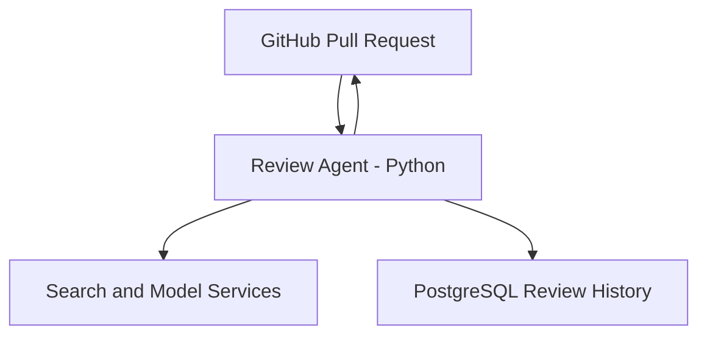

# DataNet Code Review Agent - Technology Stack (Reduced)

**Status:** Proposed reduction of v1.0, per team lead feedback
**Version:** 2.0
**Project:** DataNet
**Related document:** `DataNet-Code-Review-Agent-SCOPE.md` (Reduced, v2.0)

## 1. Architecture Decision

The MVP uses **one application service**, not two:

**Review Agent Service** - a single Python service that receives GitHub events, runs the LangGraph workflow, retrieves code and documentation context, calls DataNet services, and publishes a single review comment back to GitHub.

This matches the original task document, which describes one Agent using LangGraph and three tools - it does not require a separate GitHub Integration service. The two-service split (TypeScript + Python) from the original technology proposal is postponed until this simpler flow works end-to-end (see Section 6).

## 2. Review Agent Service

### Language and Runtime

- **Language:** Python.
- **Runtime:** Python 3.12.
- **Type hints:** required for public functions and domain models.

### Core Libraries and Tools

| Responsibility | Technology |
| --- | --- |
| Webhook and internal HTTP API | FastAPI |
| Request and response validation | Pydantic |
| Agent workflow | LangGraph |
| Calls to GitHub, Search Service, Model Service | httpx |
| Local repository search | Git and `ripgrep` (or plain text search) |
| Review history storage | PostgreSQL |
| Unit and integration tests | pytest |
| Packaging | Docker |

### Responsibilities

The service owns everything:

- GitHub App configuration and Webhook signature verification.
- Handling `pull_request.opened`, `pull_request.synchronize`, and a `/review` comment trigger.
- Reading PR metadata, diff, and changed files through the GitHub REST API.
- The LangGraph review state, nodes, and tools.
- DataNet component classification.
- Repository and documentation context collection.
- Calls to the DataNet Search Service and DataNet Model Service.
- Grounding and validation of findings.
- Score calculation and final recommendation.
- Publishing one summary comment to the PR through the GitHub REST API.
- Storing basic review-run history in PostgreSQL.

## 3. GitHub Integration (folded into the one service)

- A GitHub App with a Webhook secret.
- `POST /webhooks/github` verifies `X-Hub-Signature-256` before accepting any event.
- Only `pull_request.opened`, `pull_request.synchronize`, and `issue_comment` (checked for `/review`) are processed; other events return `200` and are ignored.
- Duplicate `X-GitHub-Delivery` IDs (or repo + PR number + head SHA) are checked against PostgreSQL before starting a run, to avoid duplicate reviews. This is a simple lookup-and-skip, not a transactional job queue.
- The Webhook endpoint returns quickly (e.g. `202`) and the review runs as a background task in the same process.
- Publishing uses a single call to the GitHub REST API to post one issue comment on the PR with the full review.

## 4. Documentation and Model Access

- Local code is searched through the Repository Search Tool (`ripgrep` or plain text search over a shallow checkout of the PR head).
- Architecture documents, coding guidelines, and API contracts are retrieved through simple document chunking and keyword search over files in the DataNet repository - no DataNet Search Service call and no vector database are required for the MVP.
- The Agent calls the DataNet Model Service (or, in local development, a directly configured LLM provider) for the review content. Model responses are validated against the Review result Pydantic schema before publication.

## 5. PostgreSQL - Minimal Schema

One simple table is enough for the MVP:

- `review_runs` - repository, PR number, head SHA, trigger type, Check Run ID (set only for a run launched from the `Run Code Review` Check Run action), status, timestamps, scores, findings (JSON), recommendation, errors.

No `webhook_deliveries`, `review_jobs`, or `review_findings` tables with locking/lease logic are needed yet - a single table with a status column and a uniqueness check on (repository, PR number, head SHA, trigger type) is sufficient to avoid duplicate runs.

## 6. What Is Explicitly Postponed

These items from the original technology proposal are valid future work, not removed permanently - they are simply out of scope until the basic flow is proven:

- A separate GitHub Integration service in TypeScript (Fastify, Octokit, Drizzle ORM).
- A durable job queue with transactional claiming, row locking, leases, and bounded retries.
- An OpenAPI contract generated between two services, with generated TypeScript types.
- Multiple containers orchestrated with Docker Compose (`github-integration`, `review-agent`, `postgres`).
- Verified line-level PR comments.
- Stale-result protection for a newer commit arriving **while a review is already running** (a mid-flight race) - distinct from the click-time head-SHA check the on-demand Check Run trigger already does (Section 5/10).
- Vitest (no TypeScript code exists in this MVP).

**No longer postponed - now part of the MVP:** GitHub Checks API integration. The on-demand trigger is a `DataNet Code Review` Check Run carrying a `Run Code Review` requested action, moved through `in_progress` to a final conclusion (`success` / `action_required` / `neutral` / `failure`). A pull_request push only creates/resets this Check Run; it never starts a review by itself - see `DataNet-Code-Review-Agent-SCOPE.md` Section 3.

## 7. Testing Stack

| Area | Tool |
| --- | --- |
| Python units and integration | pytest |
| Webhook signature verification | pytest, with a valid and an invalid signature test |
| GitHub interactions | Mocked `httpx` responses and saved Webhook fixtures |
| LangGraph | Fake Search Tool, Fake Model Client, deterministic fixtures |
| End-to-end | Sample repository and sample PR with known violations |

## 8. Container and Deployment

- **One container** for the Review Agent service.
- PostgreSQL runs as a second container for local development (via `docker compose up`), but it is a data store, not a second application service.
- Local development may configure the Model Service call to use Ollama; an approved cloud provider can be used later without changing Agent code.

## 9. Configuration Boundaries

Environment variables needed for the MVP:

- `GITHUB_APP_ID`, `GITHUB_PRIVATE_KEY`, `GITHUB_WEBHOOK_SECRET`.
- `DATABASE_URL`.
- `LLM_API_KEY`, `LLM_MODEL` (or `MODEL_SERVICE_URL` if calling the DataNet Model Service).
- `LOG_LEVEL`.

The service must refuse to start if a required environment variable is missing. Secrets must never be committed, included in images, returned by APIs, or written to logs.

## 10. Final Approved Stack (Reduced)

| Layer | Approved Choice |
| --- | --- |
| Service language | Python 3.12 |
| HTTP framework | FastAPI |
| Agent workflow | LangGraph |
| GitHub access | GitHub REST API via `httpx` |
| On-demand trigger | GitHub Checks API (`DataNet Code Review` Check Run + `Run Code Review` requested action) |
| Data models | Pydantic |
| Review history | PostgreSQL (single table) |
| Code search | `ripgrep` / plain text search |
| Documentation retrieval | Local document chunking and keyword search |
| LLM access | DataNet Model Service (or Ollama locally) |
| Tests | pytest |
| Packaging | Docker (single service container + PostgreSQL) |
| Local orchestration | Docker Compose (two containers only) |
| Future scale option | Split into a separate GitHub Integration service and a job queue - once this flow is proven |

## 11. Definition of Done for Technology Selection

This reduced stack is complete when the team accepts this document, the single-service structure is reflected in the repository, and the items in Section 6 are not started before the basic end-to-end flow works.
